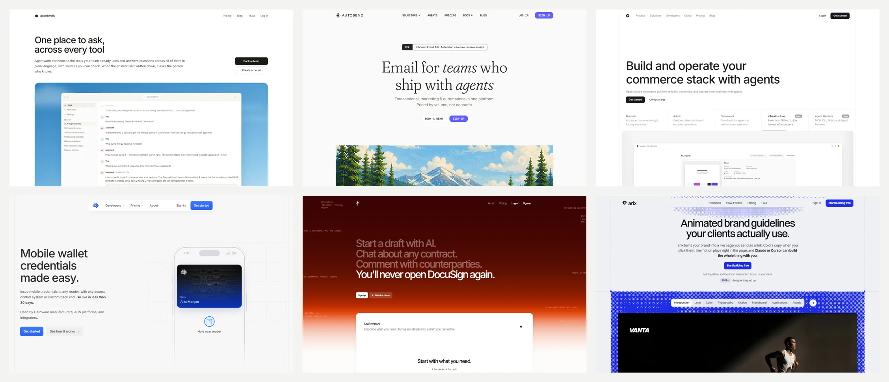
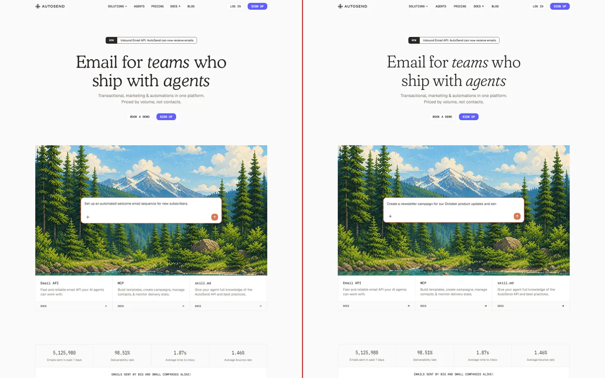
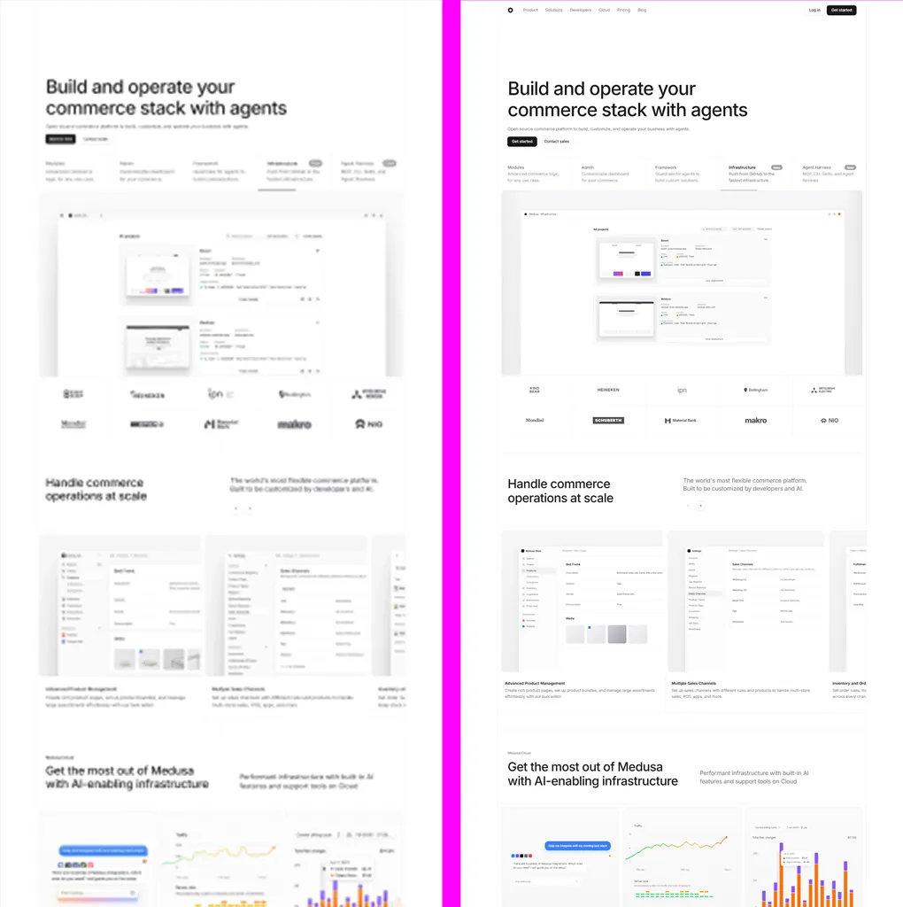
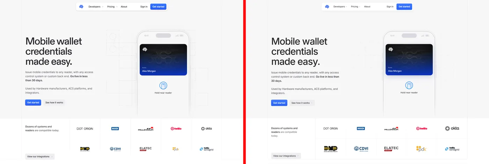
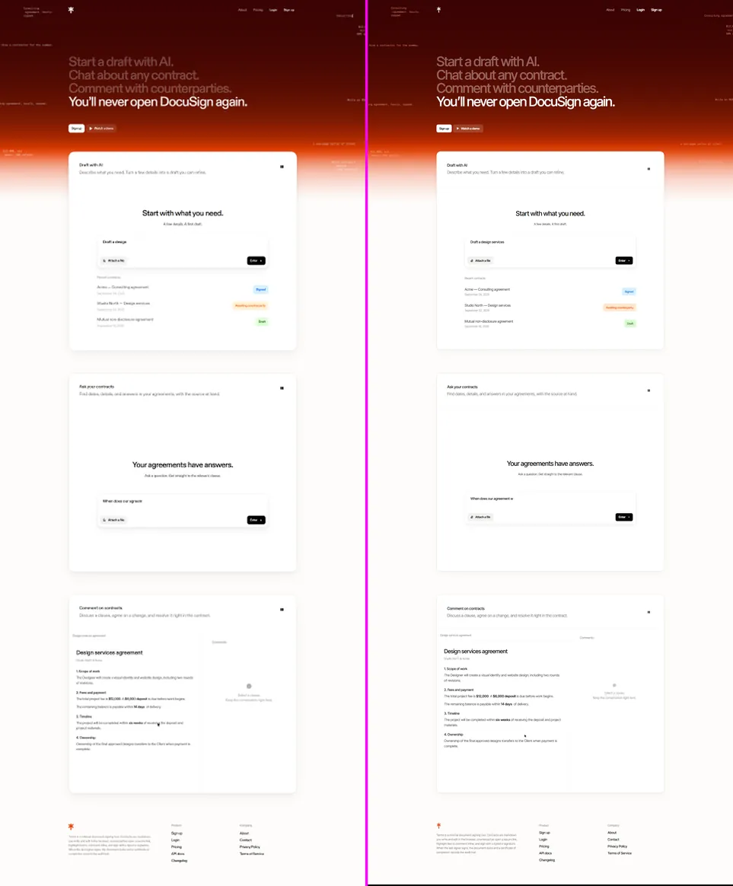
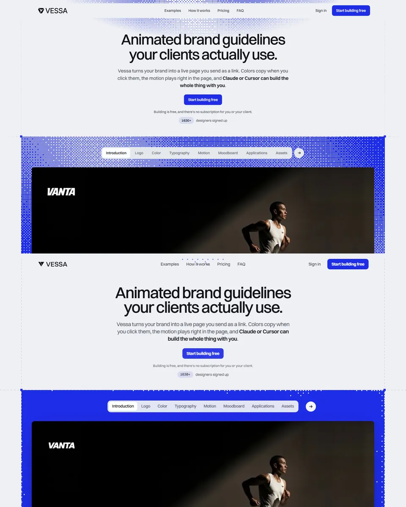
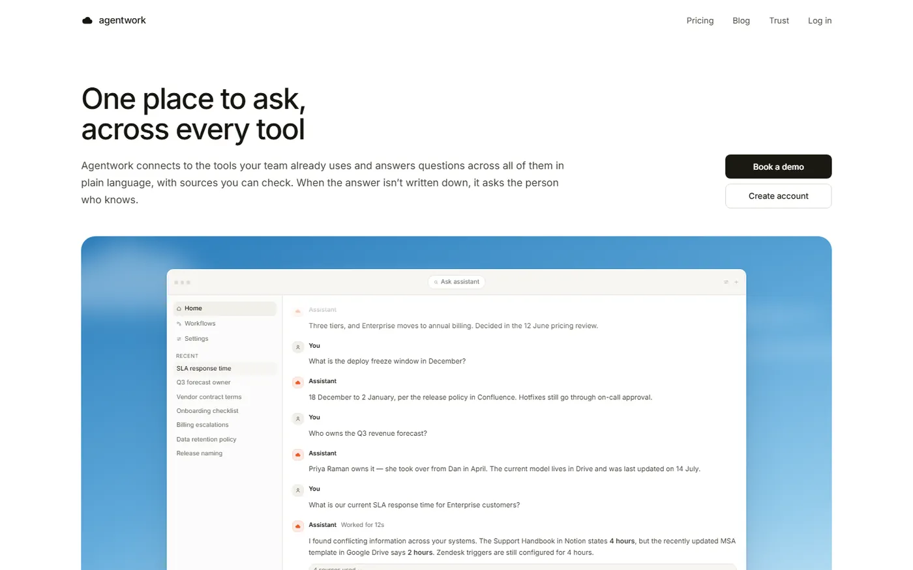

<div align="center">

# design-to-code

**Give your AI agent a design image. Get back a real, responsive website.**

An agent skill that turns screenshots, mockups, Figma frames, and live pages into production frontend code,
and then checks its own work against the design until the two match.

[](https://athrix.me)
[](https://x.com/athrix_codes)
[](LICENSE)
[](design-to-code/SKILL.md)
[](websites)

<br />



<sub>Every page above was built by an AI agent from nothing but a design image.</sub>

</div>

<br />

## I built these websites from design images only

No Figma file. No source code. No design tokens. No hand-off doc.

Each site in this repo started as **a single picture of a page**, sometimes a crisp full-page screenshot and
sometimes a blurry, low-resolution thumbnail. I gave that image to an AI agent running the `design-to-code`
skill, and the agent did the rest:

- read the layout, spacing, colors, and type straight from the pixels
- identified or matched the fonts
- rebuilt every section as real, semantic HTML and components (not a screenshot pasted behind the page)
- made it responsive for screen sizes the design never showed
- took screenshots of its own build, compared them against the design, and fixed the differences

The result is six working Next.js sites you can clone, run, and read. The comparisons below put the
original design image next to what the agent shipped.

> The skill is the product. The websites are the proof.

<br />

## Design image vs. shipped code

<table>
  <tr>
    <td width="50%" valign="top">
      
      <p><b>AutoSend</b> · email platform<br /><sub>Left: design image. Right: the built page. Serif display type, pixel-art hero, agents, SDK, and webhook sections.</sub></p>
    </td>
    <td width="50%" valign="top">
      
      <p><b>Medusa</b> · commerce platform<br /><sub>Left: a blurry, low-res reference. Right: the sharp rebuild. The agent recovered the layout and copy from a soft image.</sub></p>
    </td>
  </tr>
  <tr>
    <td width="50%" valign="top">
      
      <p><b>AccessGrid</b> · NFC access passes<br /><sub>Left: design image. Right: the built page. Floating nav, phone mockup, and a wallet card rebuilt in code.</sub></p>
    </td>
    <td width="50%" valign="top">
      
      <p><b>Terms</b> · AI contracts<br /><sub>Left: design image. Right: the built page. Gradient hero, Ask / Comment / Draft demos, set in Geist.</sub></p>
    </td>
  </tr>
  <tr>
    <td width="50%" valign="top">
      
      <p><b>arix</b> · animated brand guidelines<br /><sub>Top: design image. Bottom: the built page. Dot-grid hero, brand tabs, and showcase video card.</sub></p>
    </td>
    <td width="50%" valign="top">
      
      <p><b>Agentwork</b> · AI workplace assistant<br /><sub>Built from one full-page screenshot pasted into chat. The app window in the hero is real DOM, not an image.</sub></p>
    </td>
  </tr>
</table>

<br />

## What's in this repo

```text
skills/
├── design-to-code/            the skill (install this)
│   ├── SKILL.md               main workflow the agent follows
│   ├── agents/openai.yaml     agent metadata
│   └── references/            playbooks the agent loads only when needed
│       ├── reference-forensics.md
│       ├── art-direction.md
│       ├── interface-craft.md
│       ├── typography-and-fonts.md
│       ├── motion.md
│       ├── verification.md
│       └── evaluations.md
├── websites/                  six sites built with the skill
│   ├── web1/  Agentwork
│   ├── web2/  AutoSend
│   ├── web3/  Medusa
│   ├── web4/  AccessGrid      (Next.js app lives in web4/app)
│   ├── web5/  Terms
│   └── web6/  arix
└── assets/                    README images
```

<br />

## Install

The quickest way is the [skills CLI](https://github.com/vercel-labs/skills):

```bash
npx skills add https://github.com/Atharvsinh-codez/skills --skill design-to-code
```

<details>
<summary><b>Manual install (Factory Droid, Claude Code, Codex, and other agents)</b></summary>

<br />

The skill is a plain folder with a `SKILL.md` file, so any agent that supports skills can use it. Clone the repo and copy the `design-to-code` folder into your agent's skills directory.

```bash
git clone https://github.com/Atharvsinh-codez/skills.git
```

| Agent | Personal (all projects) | Project only |
|---|---|---|
| Factory Droid | `~/.factory/skills/design-to-code/` | `<repo>/.factory/skills/design-to-code/` |
| Claude Code | `~/.claude/skills/design-to-code/` | `<repo>/.claude/skills/design-to-code/` |
| Codex | `~/.codex/skills/design-to-code/` | `<repo>/.codex/skills/design-to-code/` |

macOS / Linux:

```bash
mkdir -p ~/.factory/skills
cp -r skills/design-to-code ~/.factory/skills/
```

Windows (PowerShell):

```powershell
New-Item -ItemType Directory -Force "$HOME\.factory\skills" | Out-Null
Copy-Item -Recurse skills\design-to-code "$HOME\.factory\skills\"
```

Restart your agent session so it picks up the new skill.

</details>

<br />

## Use it

Drop a design image into your agent and ask for code. The skill activates on requests like these:

```text
Recreate this website in Next.js. Match it exactly.
```

```text
Turn this screenshot into a responsive landing page using our existing components.
```

```text
Here's a Figma frame. Build it, then make it work on mobile.
```

```text
This page doesn't match the design anymore. Find the visual differences and fix them.
```

It works with React, Next.js, Vue, Svelte, plain HTML/CSS, or whatever stack your project already uses.

<br />

## How it works

The skill turns "make it look like this" into a strict, repeatable process. The agent follows it step by step.

1. **Pick the mode.** Exact reconstruction, greenfield art direction, hybrid expansion, variants, or repair. In reconstruction mode the design image is the authority, and the agent is not allowed to "improve" it into its own taste.
2. **Read the design like a forensic analyst.** Measure the grid, container width, spacing rhythm, type scale, radii, shadows, and colors directly from the pixels. Every value is tagged as observed, inferred, or substituted, so nothing is guessed silently.
3. **Get the fonts right.** Identify the typeface, check its license, and pick the closest legal match when the original is commercial. When nothing fits, the skill falls back to Geist Serif (or Geist Sans / Mono for clearly sans or mono designs) instead of a random default.
4. **Lock a fidelity contract.** Decide what must match exactly, what may adapt, and what was never visible in the image.
5. **Build from macro to micro.** Page structure first, then sections, then components, then fine details such as borders, focus rings, and hover states.
6. **Recompose for every screen.** A screenshot shows one width. The skill rebuilds the layout for tablet and mobile instead of just shrinking it.
7. **Add motion with taste.** Purposeful, fast, interruptible transitions that respect `prefers-reduced-motion`, based on proven interface-motion principles.
8. **Verify by rendering.** The agent screenshots its own build, puts it next to the design, and fixes the differences. It also checks overflow, contrast, keyboard access, fonts actually loading, and console errors.
9. **Give an honest verdict.** It reports what matches, what was inferred, and what is still off, instead of declaring "pixel-perfect" without evidence.

<br />

## What makes the output different

| Typical AI output | With design-to-code |
|---|---|
| Looks "close enough" at one screen size | Measured against the design, then rebuilt for mobile and tablet |
| Random system font or Inter everywhere | Font identified, licensed, matched, and checked to load |
| Emoji and icon-font placeholders | Clean inline SVG icons only |
| Screenshot pasted in as a background | Real semantic HTML you can edit, translate, and index |
| "Done!" with no proof | Side-by-side render comparison and a readiness verdict |
| Bouncy, slow, decorative animation | Short, purposeful motion with a reduced-motion fallback |
| Divs everywhere | Landmarks, headings, labels, focus states, WCAG AA contrast |

<br />

## Run the example sites

Each site is a standalone Next.js 16 project.

```bash
git clone https://github.com/Atharvsinh-codez/skills.git
cd skills/websites/web1        # or web2, web3, web5, web6
npm install
npm run dev
```

AccessGrid keeps its app one level deeper:

```bash
cd skills/websites/web4/app
npm install
npm run dev
```

Then open [http://localhost:3000](http://localhost:3000).

<br />

## FAQ

<details>
<summary><b>Do I need a Figma file?</b></summary>
<br />
No. That's the point. Every site in this repo was built from a design image alone. A Figma frame, a live URL, or a set of screenshots at different widths gives the agent more evidence, but a single PNG is enough to start.
</details>

<details>
<summary><b>Will it match the design pixel for pixel?</b></summary>
<br />
It gets very close, and it tells you exactly where it isn't. Text renders differently from a screenshot, licensed fonts sometimes need a substitute, and anything the image never showed (hover states, mobile layout) has to be inferred. The skill records each of those decisions instead of hiding them.
</details>

<details>
<summary><b>What if the screenshot is blurry or low resolution?</b></summary>
<br />
It still works. The Medusa example was built from a soft, low-res reference. The agent reads structure and proportions from what it can see, and marks anything uncertain as inferred.
</details>

<details>
<summary><b>Which framework does it output?</b></summary>
<br />
Whatever your project uses. If you start from an empty folder, it picks a sensible modern stack. All six examples here use Next.js 16 and React 19.
</details>

<details>
<summary><b>Which agents does it work with?</b></summary>
<br />
Any agent that supports the open skills format: Factory Droid, Claude Code, Codex, and others. The workflow lives in plain Markdown, so you can also read it and follow it yourself.
</details>

<details>
<summary><b>Can I use the example sites commercially?</b></summary>
<br />
Not as-is. The code is MIT, but the designs, brand names, and logos they reproduce belong to their owners. Use the sites to study the technique, and use the skill to build your own designs.
</details>

<br />

## Credits

- Motion guidance in `references/motion.md` is adapted from [Emil Kowalski's skills](https://github.com/emilkowalski/skills) (MIT).
- README layout inspired by [taste-skill](https://github.com/Leonxlnx/taste-skill).
- [Geist](https://vercel.com/font) by Vercel is the fallback type family (SIL Open Font License).

## Disclaimer

The example websites are study reconstructions of publicly visible designs, made to show what the skill can do. All product names, logos, and brand designs belong to their respective owners. This project is not affiliated with or endorsed by any of them.

<br />

<div align="center">

### Made by Atharv Jadav

If this skill saved you time, a star on the repo helps a lot.

[](https://athrix.me)
[](https://x.com/athrix_codes)

<sub>Questions, ideas, or something you built with it? Reach out on <a href="https://x.com/athrix_codes">X</a>.</sub>

<br />
<br />

<sub>MIT License · Copyright (c) 2026 Atharv Jadav</sub>

</div>
